# AeroMaint

**Equipment maintenance management for an airport authority.**

Airport staff report equipment faults, supervisors assign them to technicians, technicians fix them,
and managers follow the numbers on a dashboard. Preventive maintenance plans create tickets
automatically when they are due, and every important action is recorded in an audit log.

The demo data is set at **Sfax-Thyna International Airport** (SFA, Tunisia): one terminal, a single
runway 15/33, baggage handling, apron, technical block. All equipment, staff and tickets are fictional.

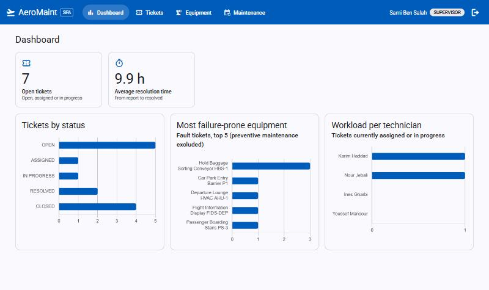

---

## Contents

- [Features](#features)
- [Tech stack](#tech-stack)
- [Architecture](#architecture)
- [Getting started](#getting-started)
- [Demo accounts](#demo-accounts)
- [Screenshots](#screenshots)
- [API overview](#api-overview)
- [Data model](#data-model)
- [CI/CD](#cicd)
- [Monitoring](#monitoring)
- [Project structure](#project-structure)
- [Pitch demo script](#pitch-demo-script)

---

## Features

| Feature | Details |
|---|---|
| **Login and roles** | JWT authentication; every endpoint and every Angular route is restricted by role |
| **Tickets** | Create, edit, delete (while OPEN), assign, change status, comment; filter by status, priority, equipment and assignee |
| **Status workflow** | `OPEN → ASSIGNED → IN_PROGRESS → RESOLVED → CLOSED`; skipping or going back is rejected |
| **Equipment register** | Equipment per zone with its full fault and maintenance history |
| **Preventive maintenance** | Plans ("every 14 days"); a scheduled job creates a ticket when a plan is due |
| **Dashboard** | Open tickets, average resolution time, most failure-prone equipment, workload per technician |
| **Audit log** | Who did what and when: logins, ticket changes, assignments, plan and equipment changes, scheduler actions |

### Roles

| Role | Can do |
|---|---|
| **TECHNICIAN** | See only the tickets assigned to them, start and resolve them, add comments |
| **SUPERVISOR** | Create, edit and assign tickets, close resolved tickets, manage maintenance plans, see the dashboard and team workload |
| **ADMIN** | Manage users, zones and equipment, see the dashboard and the audit log; read-only on tickets |

### Ticket workflow

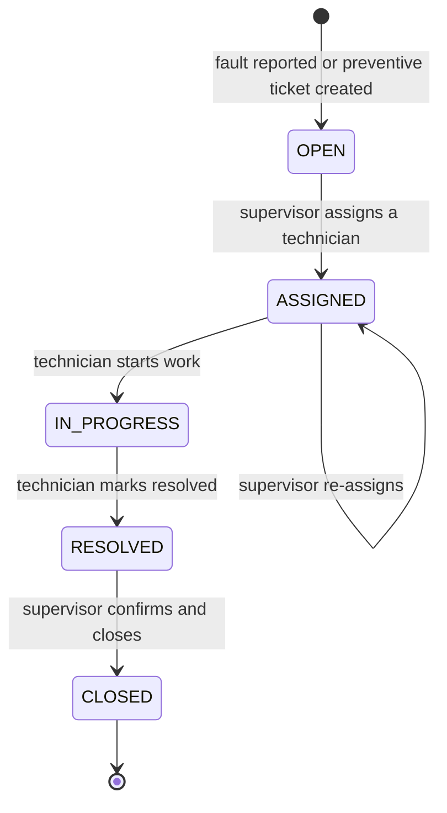

Any other transition returns `409 Conflict` (for example `OPEN → IN_PROGRESS` or `CLOSED → IN_PROGRESS`).

---

## Tech stack

| Layer | Technologies |
|---|---|
| Backend | Java 17, Spring Boot 3.5, Spring Security + JWT (JJWT), Spring Data JPA / Hibernate, Bean Validation, Flyway, springdoc OpenAPI (Swagger UI) |
| Database | MySQL 8.4 (MariaDB in local development) |
| Frontend | Angular 22 (standalone components, signals), Angular Material, Chart.js |
| DevOps | Docker (multi-stage builds), Docker Compose, Nginx, GitHub Actions, GitHub Container Registry |
| Monitoring | Spring Boot Actuator, Micrometer, Prometheus, Grafana |

---

## Architecture

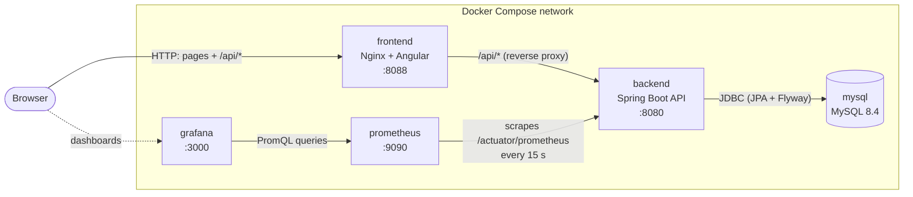

**How a request flows**

1. The browser loads the Angular app from Nginx and calls `/api/...` on the same address (no CORS).
2. Nginx forwards `/api/*` to the backend container.
3. `JwtAuthenticationFilter` checks the `Authorization: Bearer <token>` header and loads the user.
4. `@PreAuthorize` on the controller checks the role (`403` if wrong).
5. The service applies the business rules (status transitions, "is this ticket yours?") and writes an audit entry
   in the same transaction.
6. `GlobalExceptionHandler` turns any error into one JSON format:
   `{ "status": 409, "message": "Invalid status transition: OPEN -> IN_PROGRESS", ... }`.

**Backend layers**

```
controller   REST endpoints, @Valid input, @PreAuthorize role checks
service      business rules, transactions, audit log, scheduler
repository   Spring Data JPA, JPQL with JOIN FETCH, statistics queries
entity       JPA entities mapped to the Flyway schema (Hibernate only validates it)
dto          Java records for requests and responses (no entity leaves the API)
security     JWT service, JWT filter, security configuration
exception    custom exceptions + global handler
```

---

## Getting started

### Option A: everything in Docker (recommended)

Requirements: **Docker Desktop**.

```bash
git clone https://github.com/Aziz389/AeroMaint.git
cd AeroMaint
cp .env.example .env        # then edit .env and put your own values
docker compose up -d --build
```

| URL | What |
|---|---|
| http://localhost:8088 | AeroMaint web app |
| http://localhost:8080/swagger-ui.html | Swagger UI (API documentation) |
| http://localhost:3000 | Grafana (user `admin`, password = `GRAFANA_ADMIN_PASSWORD`) |
| http://localhost:9090/alerts | Prometheus alerts |

Useful commands:

```bash
docker compose logs -f backend    # follow the backend log
docker compose down               # stop, keep the data
docker compose down -v            # stop and delete the database
```

On first start, Flyway creates the tables and loads the demo data, and the demo users get the password from
`DEMO_PASSWORD`. About 15 seconds later the maintenance scheduler creates tickets for the plans that are due.

### Option B: local development (without Docker)

Requirements: **JDK 17+**, **Maven 3.9+**, **Node.js 24**, **Angular CLI**, and **MySQL 8 or MariaDB 10.6+**
(for example XAMPP).

1. Create an empty database and a user:

   ```sql
   CREATE DATABASE aeromaint CHARACTER SET utf8mb4 COLLATE utf8mb4_unicode_ci;
   CREATE USER 'aeromaint'@'localhost' IDENTIFIED BY 'choose-a-password';
   GRANT ALL PRIVILEGES ON aeromaint.* TO 'aeromaint'@'localhost';
   ```

2. Copy `.env.example` to `.env` and fill in `DB_PASSWORD`, `JWT_SECRET` and `DEMO_PASSWORD`.
   The backend reads `.env` automatically.

3. Start the backend (Flyway creates the tables on first start):

   ```bash
   cd backend
   mvn package
   java -jar target/aeromaint-backend-0.0.1-SNAPSHOT.jar
   ```

4. Start the frontend in another terminal:

   ```bash
   cd frontend
   npm install
   npm start
   ```

   Open http://localhost:4200. The Angular dev server forwards `/api` to `localhost:8080` (`proxy.conf.json`).

### Environment variables

All secrets come from environment variables (or the `.env` file). Nothing secret is committed.

| Variable | Used by | Purpose |
|---|---|---|
| `DB_URL` | backend (local run) | JDBC URL; Docker Compose overrides it to point at the `mysql` container |
| `DB_USERNAME`, `DB_PASSWORD` | backend, MySQL container | application database account |
| `MYSQL_ROOT_PASSWORD` | MySQL container | MySQL root password |
| `JWT_SECRET` | backend | HMAC-SHA256 signing key, at least 32 characters |
| `JWT_EXPIRATION_MS` | backend | token lifetime (default 1 hour) |
| `DEMO_PASSWORD` | backend | password given to the seeded demo users on first start |
| `GRAFANA_ADMIN_PASSWORD` | Grafana | Grafana `admin` password |
| `TZ` | containers | time zone, default `Africa/Tunis` (used for "today" in the scheduler) |

---

## Demo accounts

Seeded by the Flyway migration `V2__seed_data.sql`. They all share the password set in `DEMO_PASSWORD`.

| Username | Name | Role |
|---|---|---|
| `admin` | Demo Admin | ADMIN |
| `sup.ben` | Sami Ben Salah | SUPERVISOR |
| `sup.trabelsi` | Leila Trabelsi | SUPERVISOR |
| `tech.karim` | Karim Haddad | TECHNICIAN |
| `tech.nour` | Nour Jebali | TECHNICIAN |
| `tech.youssef` | Youssef Mansour | TECHNICIAN |
| `tech.ines` | Ines Gharbi | TECHNICIAN |

---

## Screenshots

| | |
|---|---|
| **Login**<br>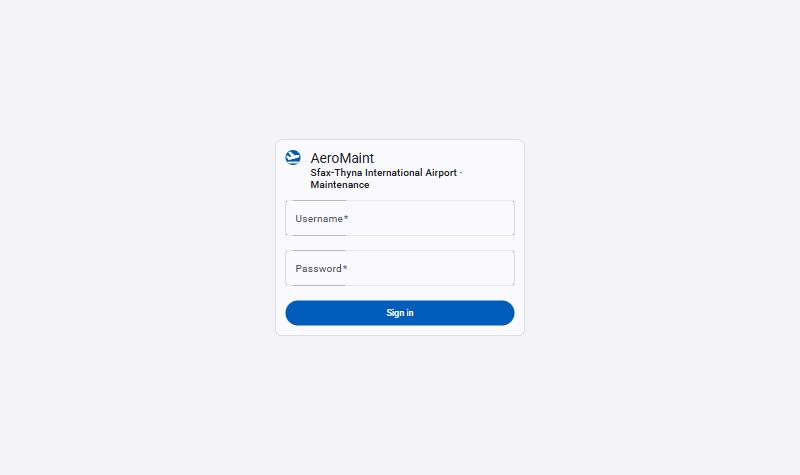 | **Dashboard** (supervisor)<br> |
| **Ticket list with filters**<br>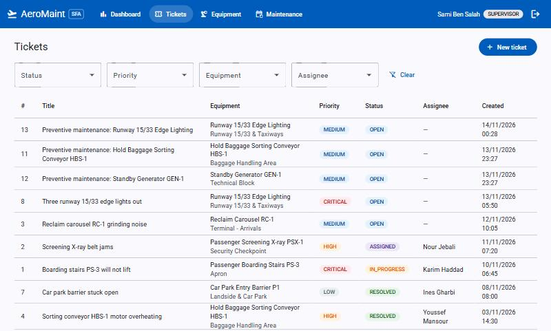 | **Ticket detail, workflow and comments**<br>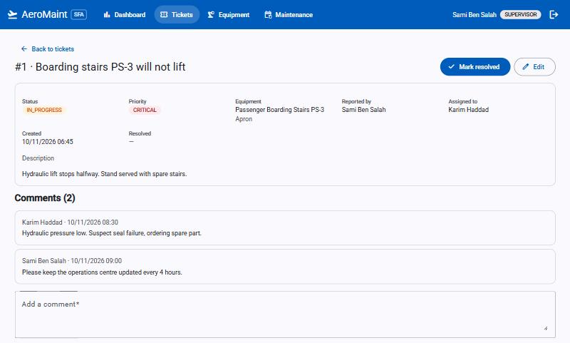 |
| **Equipment history**<br>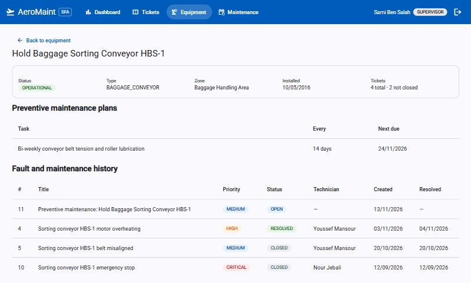 | **Preventive maintenance plans**<br>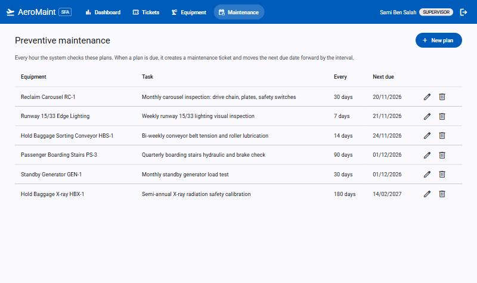 |
| **Grafana monitoring**<br>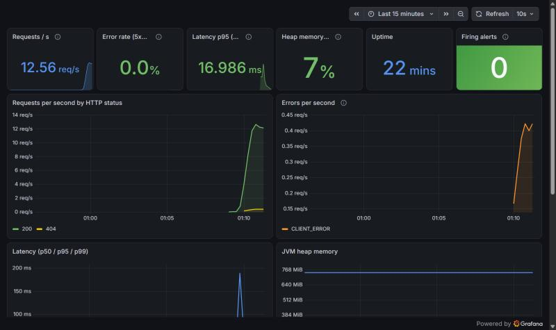 | |

---

## API overview

Full, interactive documentation: **Swagger UI** at `/swagger-ui.html`
(log in with `POST /api/auth/login`, then click **Authorize** and paste the token).

| Method | Endpoint | Roles | Description |
|---|---|---|---|
| POST | `/api/auth/login` | public | Username + password → JWT |
| GET | `/api/auth/me` | all | Current user |
| GET | `/api/users?role=` | ADMIN, SUPERVISOR | List users (supervisors use it to pick technicians) |
| GET / POST / PUT | `/api/users`, `/api/users/{id}` | ADMIN | Read, create, update (or deactivate) users |
| GET | `/api/zones`, `/api/zones/{id}` | all | List / read zones |
| POST / PUT / DELETE | `/api/zones`, `/api/zones/{id}` | ADMIN | Manage zones (a zone with equipment cannot be deleted) |
| GET | `/api/equipment`, `/api/equipment/{id}` | all | List / read equipment |
| GET | `/api/equipment/{id}/history` | SUPERVISOR, ADMIN | All tickets and maintenance plans of one equipment |
| POST / PUT / DELETE | `/api/equipment`, `/api/equipment/{id}` | ADMIN | Manage equipment (equipment with history cannot be deleted) |
| GET | `/api/tickets?status=&priority=&equipmentId=&assigneeId=` | all | Filtered list (technicians only get their own tickets) |
| GET | `/api/tickets/{id}` | all | One ticket (technicians: only if assigned to them) |
| POST / PUT | `/api/tickets`, `/api/tickets/{id}` | SUPERVISOR | Create / edit a ticket |
| DELETE | `/api/tickets/{id}` | SUPERVISOR | Delete a ticket that is still OPEN |
| PUT | `/api/tickets/{id}/assign` | SUPERVISOR | Assign or re-assign to an active technician |
| PATCH | `/api/tickets/{id}/status` | TECHNICIAN, SUPERVISOR | Move to the next status (only supervisors close) |
| GET / POST | `/api/tickets/{id}/comments` | all / TECHNICIAN, SUPERVISOR | Read / add comments |
| GET | `/api/maintenance-plans` | SUPERVISOR, ADMIN | List plans |
| POST / PUT / DELETE | `/api/maintenance-plans`, `/{id}` | SUPERVISOR | Manage plans |
| GET | `/api/dashboard` | SUPERVISOR, ADMIN | Statistics for the dashboard |
| GET | `/api/audit-log` | ADMIN | 200 most recent audit entries |
| GET | `/actuator/health`, `/actuator/prometheus` | internal | Health and metrics (not exposed by Nginx) |

**Error responses** always have the same shape:

| Status | When |
|---|---|
| 400 | Validation failed (`fieldErrors` lists each invalid field), malformed JSON, bad parameter |
| 401 | Missing, invalid or expired token; wrong username or password |
| 403 | Logged in, but the role (or ticket ownership) does not allow it |
| 404 | Object or endpoint not found |
| 409 | Business rule broken (invalid status transition, duplicate name, delete with history...) |
| 500 | Unexpected error (details only in the server log) |

---

## Data model

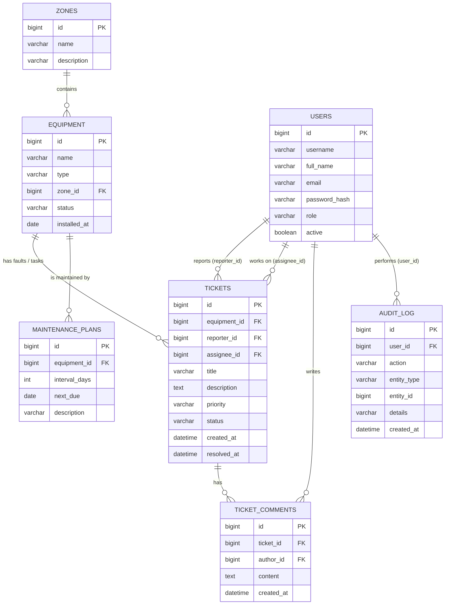

- The schema is created by **Flyway** migrations in `backend/src/main/resources/db/migration`
  (`V1__create_schema.sql`, `V2__seed_data.sql`); Hibernate only validates it (`ddl-auto: validate`).
- `reporter_id` is NULL for tickets created by the maintenance scheduler; `audit_log.user_id` is NULL for system actions.
- Enums are stored as `VARCHAR` so the same SQL runs on MySQL and MariaDB.

---

## CI/CD

GitHub Actions workflow: [`.github/workflows/ci-cd.yml`](.github/workflows/ci-cd.yml)

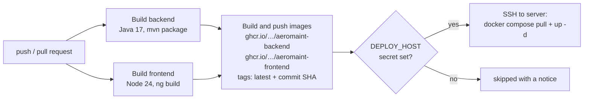

- Pull requests only run the two build jobs; images and deployment only run on `main`.
- The registry login uses the automatic `GITHUB_TOKEN`; no registry secret is needed.
- Server setup, secrets and rollback are described in [`docs/deployment.md`](docs/deployment.md).
  On the server, `docker-compose.prod.yml` pulls the images instead of building them and hides the backend
  and Prometheus from the internet.

---

## Monitoring

- **Actuator + Micrometer** expose `/actuator/prometheus` (request counts and duration histograms per endpoint
  and status, JVM memory, uptime...).
- **Prometheus** scrapes the backend every 15 seconds ([`docker/prometheus`](docker/prometheus)).
- **Grafana** is provisioned from files ([`docker/grafana`](docker/grafana)): the data source and the
  *AeroMaint Backend* dashboard load automatically.
  Panels: requests/s, 5xx error rate, p95 latency, heap usage, uptime, firing alerts, requests by status,
  4xx/5xx errors per second, latency p50/p95/p99, JVM heap, requests per endpoint.
- **Alert rule `HighErrorRate`**: fires when more than **5 %** of API requests return a **5xx** error over
  5 minutes, for at least **2 minutes**. Tested by stopping MySQL: inactive → pending → firing after about 3 minutes.

---

## Project structure

```
AeroMaint/
├── backend/                     Spring Boot API
│   ├── src/main/java/com/aeromaint/
│   │   ├── config/              OpenAPI, demo password initializer
│   │   ├── controller/          REST controllers
│   │   ├── dto/                 request / response records
│   │   ├── entity/              JPA entities and enums
│   │   ├── exception/           custom exceptions, global handler
│   │   ├── repository/          Spring Data repositories
│   │   ├── security/            JWT service, filter, security config
│   │   └── service/             business logic, scheduler, audit, dashboard
│   ├── src/main/resources/
│   │   ├── application.yml
│   │   └── db/migration/        Flyway SQL migrations
│   └── Dockerfile
├── frontend/                    Angular app
│   ├── src/app/
│   │   ├── core/                models, services, auth interceptor and guards
│   │   ├── layout/              toolbar and navigation
│   │   └── pages/               login, dashboard, tickets, equipment, maintenance, audit
│   ├── nginx.conf
│   └── Dockerfile
├── docker/
│   ├── prometheus/              scrape config and alert rules
│   └── grafana/                 data source, dashboard provisioning and JSON
├── docs/                        deployment guide, screenshots
├── .github/workflows/ci-cd.yml  CI/CD pipeline
├── docker-compose.yml           full local stack
├── docker-compose.prod.yml      server overrides
└── .env.example                 list of required variables (fake values)
```

---

## Pitch demo script

A 5-minute walkthrough. Start the stack beforehand (`docker compose up -d`), open the app on
http://localhost:8088 and Grafana on http://localhost:3000 in a second tab.

**1. The problem (30 s)**
> "At an airport like Sfax-Thyna, a broken baggage conveyor or a dark runway light has to be reported,
> assigned and fixed fast, and preventive checks must never be forgotten. Today that is often phone calls
> and paper. AeroMaint puts the whole cycle in one tool."

**2. Supervisor view (1 min 30)**: log in as `sup.ben`
- **Dashboard**: open tickets, average resolution time, the most failure-prone equipment (sorting
  conveyor HBS-1 with 3 faults), and the workload of each technician.
- **Tickets**: filter on *CRITICAL*. Open *"Three runway 15/33 edge lights out"* and assign it to
  **Nour Jebali**. Point out that it moved to *ASSIGNED*.
- **Maintenance**: show the plans. "Every hour the system checks these; when one is due it creates a ticket
  by itself." Show the *Preventive maintenance: …* tickets the scheduler created.

**3. Technician view (1 min)**: log out, log in as `tech.nour`
- Only her tickets are visible, and there is no dashboard or *New ticket* button.
- Open the runway ticket → **Start work** → add a comment → **Mark resolved**.
- "She cannot close it herself: a supervisor checks the work first."

**4. Back to the supervisor (30 s)**: log in as `sup.ben`
- Open the ticket → **Close ticket**. The dashboard numbers update.
- **Equipment → HBS-1**: the full fault and maintenance history of one machine.

**5. Traceability and security (30 s)**: log in as `admin`
- **Audit log**: every step just done, with who and when, including the scheduler.
- "Every endpoint checks the role on the server; hiding buttons in the browser is only for convenience."

**6. Operations (1 min)**
- **Grafana**: requests per second, error rate, p95 latency, memory, and the *HighErrorRate* alert.
- "The whole stack starts with one `docker compose up`; every push to GitHub builds and tests the code,
  publishes Docker images, and can deploy them to a server."

**Closing line**
> "Fault reporting, assignment, preventive maintenance, statistics, audit and monitoring:
> one secure, containerised application, ready to deploy."
